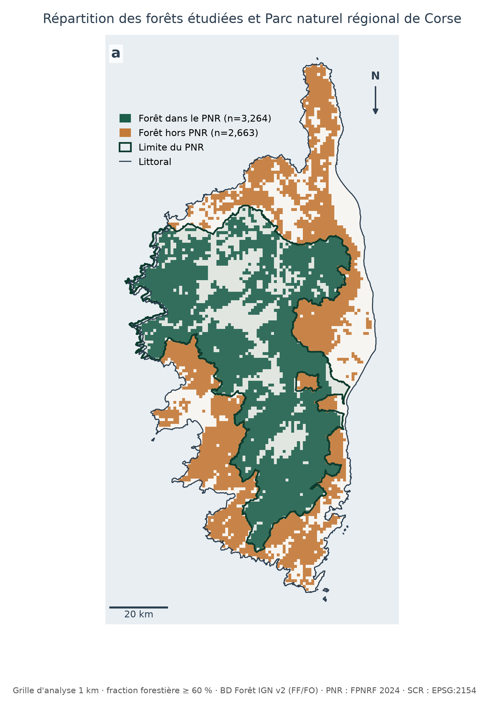
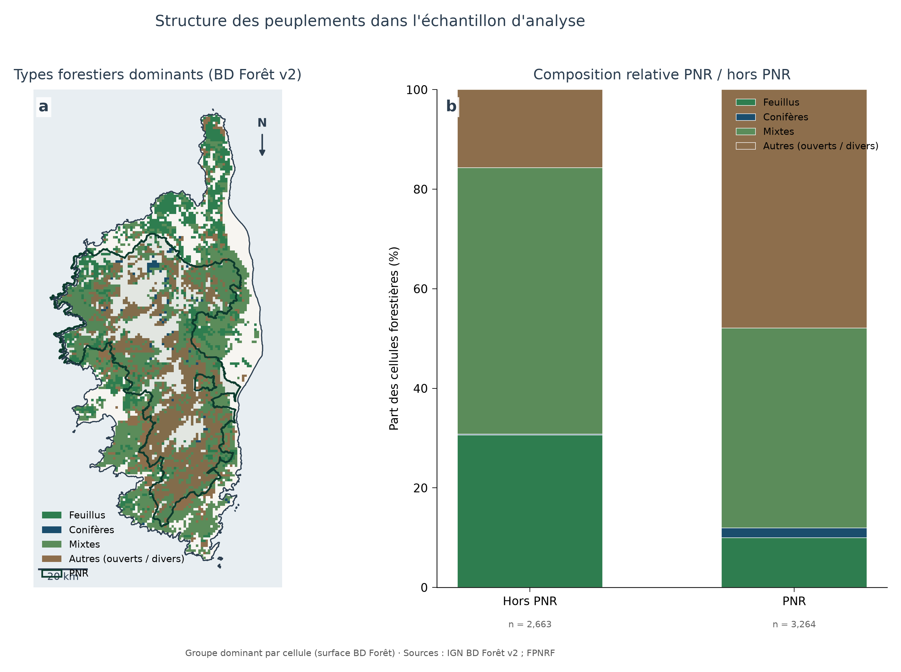
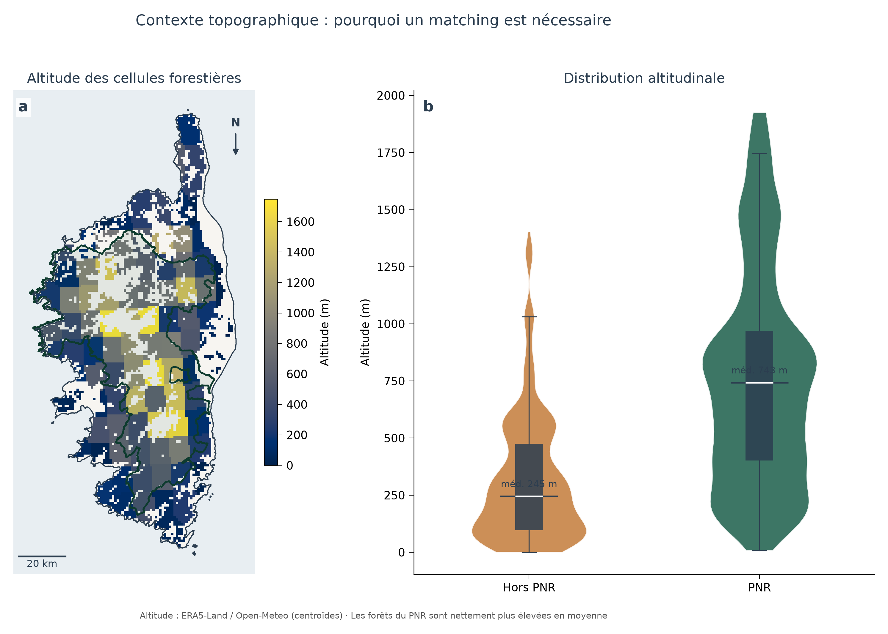
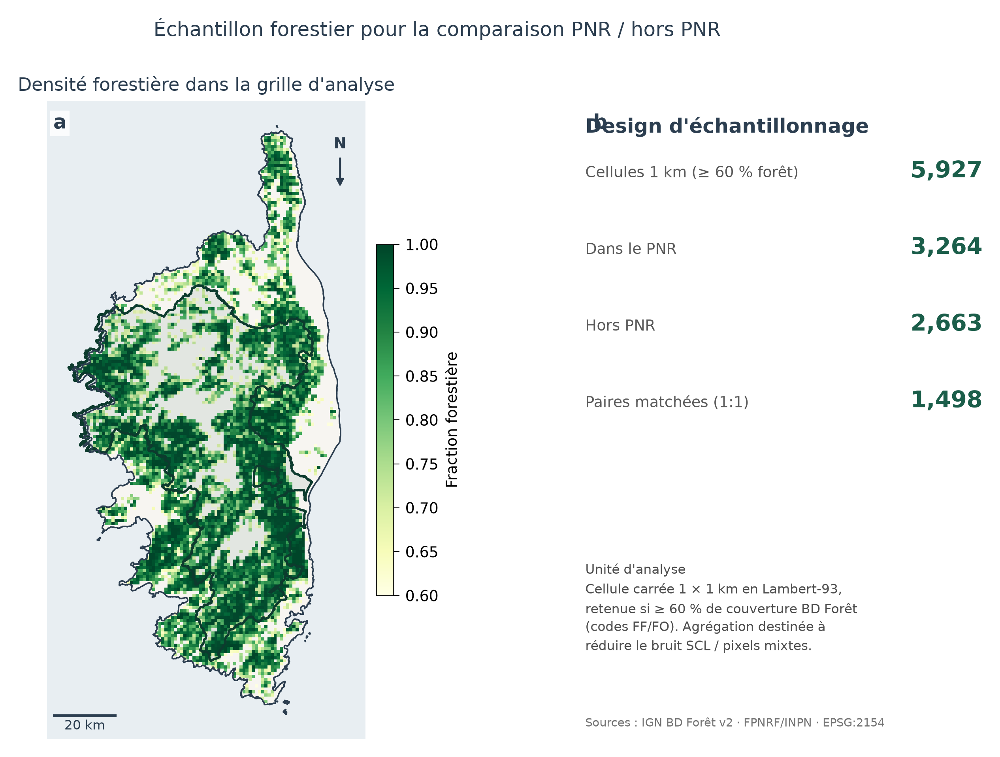
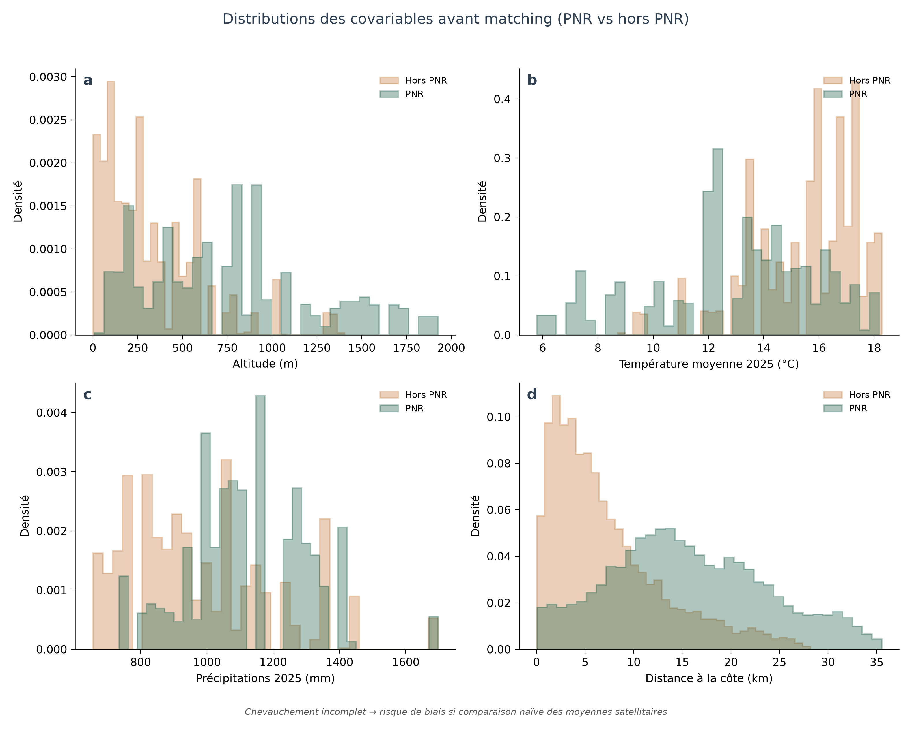
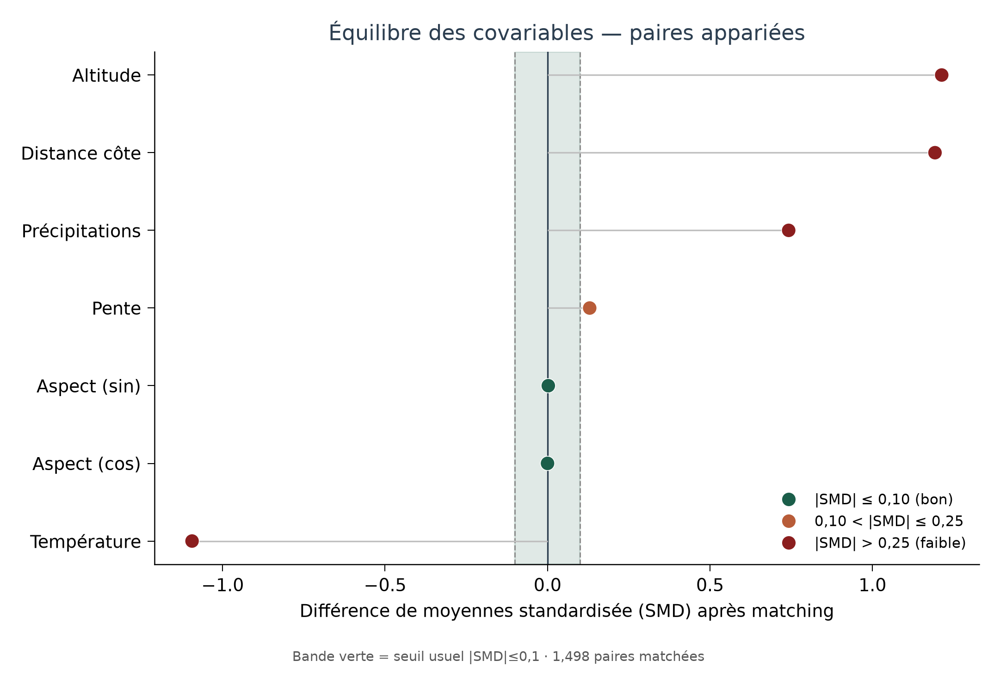
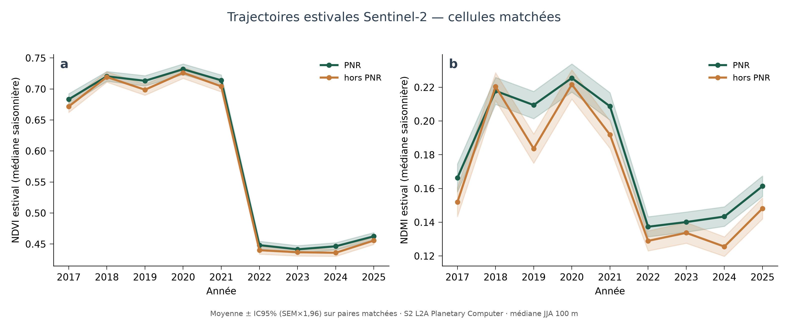
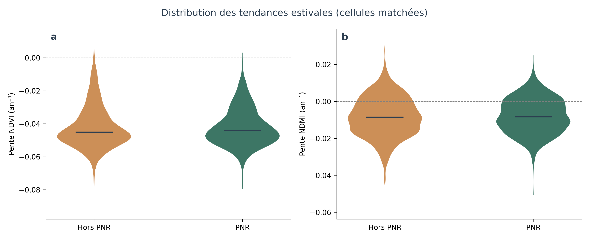
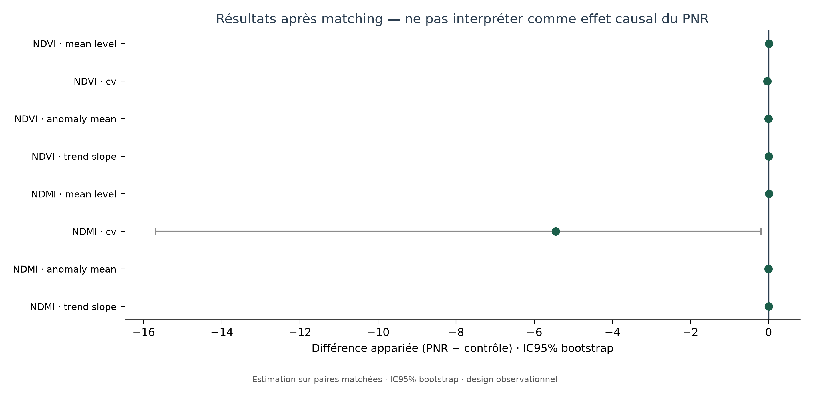

# Trajectoires forestières Sentinel-2 à l’intérieur et à l’extérieur du PNR de Corse

**Étude observationnelle par télédétection — rapport de résultats**  
Date : 24 septembre 2026  
Projet : `corsica_forest_resilience`  
Statut : pipeline exécuté de bout en bout (données officielles → matching → S2 2017–2025 → tests appariés → figures).

> **PDF publiable (recommandé) :** [`../outputs/figures/Rapport_PNR_Corse_Trajectoires_Forestieres.pdf`](../outputs/figures/Rapport_PNR_Corse_Trajectoires_Forestieres.pdf)  
> Régénération : `py -m src.publication_report`  
> Figures : `../outputs/figures/pub_fig*.png`

---

## Résumé

Sur **1 495 paires** de cellules forestières 1 km matchées (PNR vs hors PNR), les **tendances estivales** NDVI et NDMI (2017–2025) ne diffèrent pas de façon détectable : les différences moyennes de pente sont ≈ 0 et les intervalles de confiance à 95 % incluent zéro. Les trajectoires se superposent, y compris le creux marqué de **2022**. Un niveau moyen de NDMI légèrement plus élevé dans le PNR (Δ ≈ +0,012) apparaît, mais reste un signal fragile. Le design est **observationnel** : ces résultats ne prouvent pas un effet causal du statut PNR.

---

## 1. Question de recherche

> Les forêts **comparables** du Parc naturel régional de Corse présentent-elles des trajectoires Sentinel-2 (activité végétale, stress hydrique canopée, stabilité, récupération) différentes des forêts hors PNR ?

Ce n’est **pas** « les forêts du PNR sont-elles meilleures ? ». Sans contrôle du biais de composition (altitude, climat, type forestier, distance à la côte), toute comparaison brute confondrait le statut de protection avec l’environnement.

---

## 2. Zone d’étude et données

### 2.1 Zone
Corse (départements 2A, 2B). Emprise PNR extraite de la couche nationale FPNRF (07/11/2024) ; ~4 495 km² en EPSG:2154.



*Figure 1 — Emprise PNR Corse et contexte insulaire.*

### 2.2 Sources principales

| Jeu | Producteur | Rôle |
|---|---|---|
| Limites PNR | FPNRF / GéoPNR (diffusion data.gouv ; référence INPN) | Masque « traité » |
| BD Forêt® v2 (2A, 2B) | IGN | Masque forêt + type (FF*/FO*) |
| Sentinel-2 L2A | ESA / Copernicus via Microsoft Planetary Computer | NDVI, NDMI |
| Climate / altitude | ERA5-Land via Open-Meteo ; élévation API | Covariables de matching |

Catalogue détaillé : [`data_catalog.md`](data_catalog.md). Références : [`references.md`](references.md).

### 2.3 Types forestiers
Masque limité aux formations arborées BD Forêt ; landes exclues. Répartition spatiale :



*Figure 2 — Types forestiers (BD Forêt v2) sur la grille d’analyse.*



*Figure 3 — Relief : les forêts PNR sont en moyenne plus élevées — d’où le matching.*

---

## 3. Méthodologie

### 3.1 Unité d’analyse
- Grille **1 km** (Lambert-93).
- Cellule retenue si fraction forêt BD Forêt **≥ 60 %**.
- Sensibilité prévue (non exécutée ici) : 500 m / 2 km.



*Figure 4 — Design : cellules forestières PNR vs hors PNR avant appariement.*

### 3.2 Prétraitement Sentinel-2
- Collection `sentinel-2-l2a` (Planetary Computer STAC).
- Fenêtre phénologique principale : **été JJA** (stress hydrique méditerranéen).
- Médiane saisonnière ; résolution de travail **200 m** ; masque SCL classes claires {4, 5, 7}.
- Indices : **NDVI** (verdure / activité), **NDMI** (proxy humidité de canopée).
- Période : **2017–2025** (9 étés).

### 3.3 Métriques de trajectoire (par cellule)
Sur la série estivale annuelle :
1. **Pente** (tendance linéaire) ;
2. **Anomalie moyenne** vs baseline précoce ;
3. **CV** interannuel ;
4. **Niveau moyen** ;
5. **Années de récupération** après chute spectrale (retour ≥ 90 % du niveau de référence ; sous-échantillon).

### 3.4 Contrôle du biais — matching
Les forêts PNR et hors PNR ne sont pas interchangeables a priori (altitude, température estivale, précipitations, distance à la côte).

**Procédure :**
- Appariement **1:1** plus proche voisin sur covariables standardisées (distance euclidienne ; caliper ≈ 0,5 √p) ;
- Covariables : altitude, pente, aspect (sin/cos), T° été, précipitations annuelles, distance à la côte, groupe de type forestier ;
- **1 498 paires** formées ; **1 495** utilisées pour les tests S2 (après exclusions de valeurs manquantes).



*Figure 5 — Distributions des covariables PNR vs hors PNR (avant / après logique d’appariement).*



*Figure 6 — Balance des covariables (SMD). Les types forestiers sont parfaitement alignés ; altitude, climat et distance à la côte gardent des SMD élevés → matching imparfait, à lire avec prudence.*

| Covariable | SMD (échantillon matché) | Moy. PNR | Moy. contrôle |
|---|---:|---:|---:|
| Altitude (m) | 1,21 | 684 | 278 |
| T° été (°C) | −1,09 | 13,4 | 15,8 |
| Dist. côte (km) | 1,19 | 13,5 | 6,1 |
| Précip. ann. (mm) | 0,74 | 1120 | 979 |
| Types forestiers | 0,00 | — | — |

*Tableau 1 — Balance post-matching. Un |SMD| < 0,1 est souvent jugé « bon » ; ici le support commun ne suffit pas à égaliser pleinement le relief et le climat.*

### 3.5 Inférence
- Différences **appariées** Δ = PNR − contrôle ;
- IC95 % par **bootstrap** des moyennes de Δ ;
- Test des signes (robustesse) ;
- **Pas de claim causal** (« le PNR cause… »).

---

## 4. Résultats

### 4.1 Trajectoires temporelles (cœur de la question)



*Figure 7 — Médianes estivales NDVI et NDMI sur cellules matchées (moyenne ± 1,96 × SEM). Les deux groupes suivent la même dynamique ; chute nette en 2022.*

Lecture :
- **2017–2021** : niveaux élevés et proches ;
- **2022** : rupture commune (verdure et humidité canopée) ;
- **2023–2025** : niveaux bas, récupération lente et parallèle.

### 4.2 Tendances et autres métriques



*Figure 8 — Distributions des pentes NDVI/NDMI (PNR vs contrôles matchés).*



*Figure 9 — Différences appariées (IC95 % bootstrap). Les pentes NDVI/NDMI sont centrées sur 0.*

| Indicateur | n paires | Δ moyen (PNR − ctrl) | IC95 % | Lecture |
|---|---:|---:|---|---|
| Pente NDVI | 1495 | −0,00017 | [−0,00105 ; 0,00068] | Pas de différence détectable |
| Pente NDMI | 1495 | +0,00035 | [−0,00035 ; 0,00112] | Pas de différence détectable |
| Niveau moyen NDVI | 1495 | +0,008 | [−0,002 ; 0,019] | Non concluant |
| Niveau moyen NDMI | 1495 | +0,012 | [+0,002 ; 0,022] | Signal faible (+) PNR |
| Anomalie NDVI / NDMI | 1495 | ≈ 0 | inclut 0 | Pas de différence |
| CV NDVI | 1495 | −0,035 | [−0,099 ; −0,002] | Variabilité un peu plus faible (prudent) |
| Récupération (années) | 339 | +0,04 | [−0,06 ; 0,15] | Pas de différence |

*Tableau 2 — Tests sur paires matchées (`outputs/tables/matched_outcome_tests.csv`).*

### 4.3 Réponse courte à la question

**Sur le support commun des cellules matchées, on n’observe pas de divergence claire des trajectoires estivales 2017–2025 entre forêts PNR et hors PNR.**  
Un avantage éventuel du PNR sur le **niveau** d’humidité canopée (NDMI) est possible mais fragile ; ce n’est pas une preuve de meilleure « résilience » au sens des tendances ou de la récupération.

---

## 5. Discussion

1. **Ce que montrent les données** : après tentative de contrôle des covariables, les dynamiques S2 estivales sont très similaires. Le choc 2022 frappe les deux groupes de façon comparable.
2. **Ce qu’elles ne montrent pas** : un effet protecteur net du PNR sur les tendances NDVI/NDMI, ni l’inverse.
3. **Biais résiduel** : le matching n’égalise pas pleinement altitude / climat / distance à la côte (SMD élevés). Une partie du Δ NDMI moyen pourrait encore refléter l’environnement plutôt que le statut PNR.
4. **Périmètre** : résultats valables pour le **support commun** (cellules appariables), pas pour l’ensemble du PNR (forêts très montagnardes sans contrepartie hors PNR).
5. **Design** : association conditionnelle aux covariables observées — **pas** d’identification causale (pas de DiD, pas d’assignation aléatoire).

---

## 6. Limites

- Masque forestier **statique** (BD Forêt v2) ;
- Élévation / climat à grain ~1 km (proxies Open-Meteo / ERA5-Land) ;
- EFFIS non intégré dans cette version (feux via proxy spectral seulement pour la métrique de récupération) ;
- Autocorrélation spatiale possible (IC bootstrap ; pas de modèle spatial formel) ;
- NDMI ≠ mesure physiologique de sécheresse ;
- Matching imparfait sur le relief et le climat.

---

## 7. Reproductibilité

```text
py -m pip install -r requirements.txt
py run_pipeline.py          # PNR, forêt, grille, covariables
py -m src.matching          # paires + balance
py -m src.run_s2_matched    # extraction S2 + métriques + tests + figures
```

Fichiers clés :
- Config : `config.yaml`
- Paires : `outputs/tables/matched_pairs.csv`
- Tests : `outputs/tables/matched_outcome_tests.csv`
- Synthèse JSON : `outputs/tables/analysis_summary.json`
- Figures : `outputs/figures/`
- Résumé court : [`EXECUTIVE_SUMMARY.md`](EXECUTIVE_SUMMARY.md)

---

## 8. Conclusion

Le projet livre un protocole EO reproductible et des **estimations empiriques** sur 1 495 paires matchées. **Conclusion empirique centrale :** pas de différence détectable des *tendances* estivales NDVI/NDMI PNR vs contrôles matchés (2017–2025). Toute interprétation en termes d’« efficacité » du PNR dépasse ce que le design autorise.

---

## Pistes suivantes (si prolongation)

1. Matching stratifié par altitude / caliper plus strict pour réduire les SMD.  
2. DEM 30 m homogène + climat 2017–2025 aligné année par année.  
3. Intégration EFFIS (feux).  
4. Analyses par type forestier.  
5. Sensibilité résolution 500 m / 2 km.
